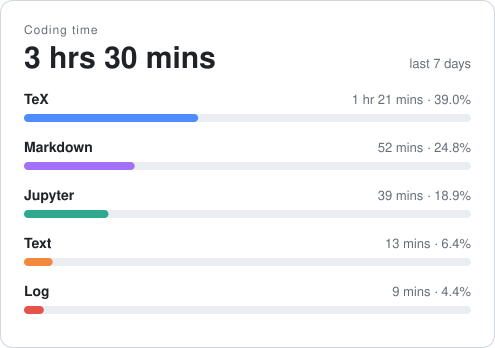

<h1 align="center">Hi, I'm Tobias Nolz 👋</h1>

  <em>AI Student @ JKU · Photographer · Developer</em>

  
  

---

### 👨‍💻 About Me

I'm passionate about exploring the intersection of **machine learning**, **data science**, and **biochemestry**.

- 🎓 Currently working on **ML and deep learning projects**
- 📸 Also a self-employed **photographer**
- 📄 Learn more on my [LinkedIn](https://www.linkedin.com/in/tobias-nolz/)

---

<h3>Weekly development breakdown</h3>

<!--START_SECTION:waka-->

<!--END_SECTION:waka-->
